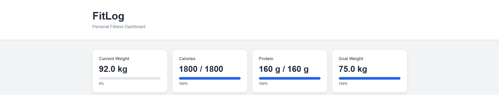
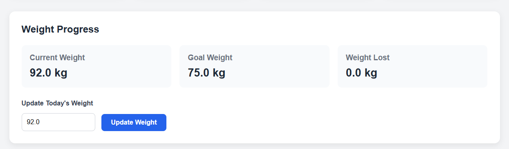
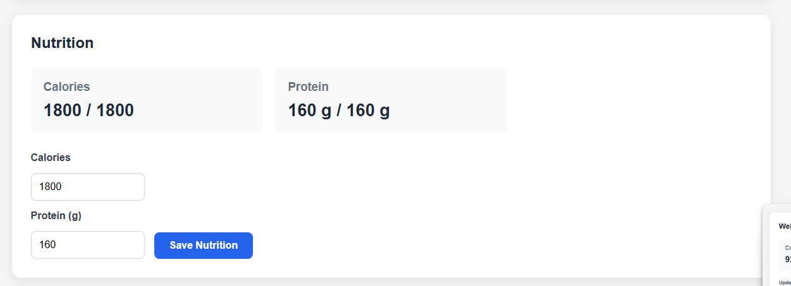
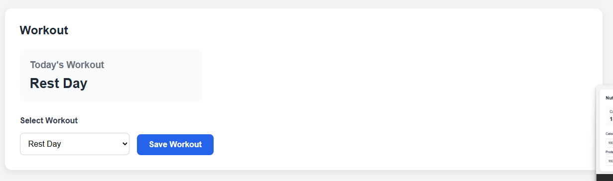

# 🏋️ FitLog

A responsive fitness tracking web application built with **React** and **Vite** that allows users to track their weight, nutrition, and daily workouts through a clean dashboard interface.

This project was developed to strengthen my front-end development skills while learning modern React concepts including state management, reusable components, controlled forms, and persistent storage.

---

## Features

- Interactive fitness dashboard
- Track current weight and weight loss progress
- Log daily calorie intake
- Log daily protein intake
- Select and save today's workout
- Persistent data using Local Storage
- Responsive design for desktop and mobile
- Built using reusable React components

---

## Built With

- React
- Vite
- JavaScript (ES6+)
- HTML5
- CSS3
- Local Storage API
- Git
- GitHub

---

## Project Structure

```
src/
├── components/
│   ├── Header.jsx
│   ├── SummaryCards.jsx
│   ├── WeightSection.jsx
│   ├── NutritionSection.jsx
│   ├── WorkoutSection.jsx
│   └── Footer.jsx
│
├── config/
│   └── defaultProfile.js
│
├── styles/
│   └── App.css
│
├── App.jsx
└── main.jsx
```

---

## Screenshots

### Dashboard



### Weight Tracking



### Nutrition Tracking



### Workout Tracking


---

## Installation

Clone the repository:

```bash
git clone https://github.com/YOUR_USERNAME/FitLog.git
```

Navigate into the project:

```bash
cd FitLog
```

Install dependencies:

```bash
npm install
```

Start the development server:

```bash
npm run dev
```

---

## What I Learned

Through this project I gained experience with:

- Building reusable React components
- Managing application state using React Hooks
- Passing data between components with props
- Creating controlled forms
- Persisting data using Local Storage
- Organising React applications into reusable modules
- Managing a project using Git and GitHub

---

## Future Improvements

Potential future features include:

- User authentication
- Exercise history
- Weight progress charts
- Nutrition history
- Dark mode
- Cloud database integration
- Backend API support

---

## License

This project is licensed under the MIT License.